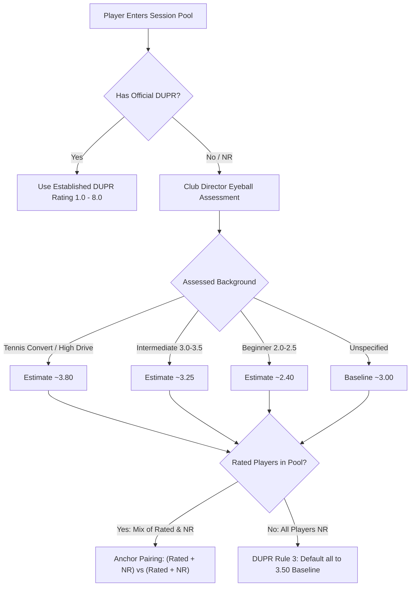

# DUPR Club Director Standard Operating Procedures & Rating Skill

This skill equips agents and club directors with official DUPR (Dynamic Universal Pickleball Rating) standards, rating calibration mechanics, unrated (NR) placement rules, and automated matchmaking algorithms tailored for the PicklePoint platform.

---

## 📋 Table of Contents
1. [Official DUPR Director Placement Principles](#1-official-dupr-director-placement-principles)
2. [NR (No Rate / Unrated) Player Calibration Rules](#2-nr-no-rate--unrated-player-calibration-rules)
3. [Smart Match Parity Engine & Team Formulas](#3-smart-match-parity-engine--team-formulas)
4. [DUPR Event Rules: Rated vs Non-DUPR Sessions](#4-dupr-event-rules-rated-vs-non-dupr-sessions)
5. [DUPR CSV Export Specification & Portal Submission](#5-dupr-csv-export-specification--portal-submission)
6. [Live Referee Scoreboard & Side-Out Mechanics](#6-live-referee-scoreboard--side-out-mechanics)
7. [Key Code References & Implementation Index](#7-key-code-references--implementation-index)

---

## 1. Official DUPR Director Placement Principles

DUPR is a dynamic rating system (scaled 1.000 to 8.000) that evaluates player skill based on match outcomes, opponent ratings, and point differentials:

1. **Every Point Counts**: DUPR analyzes game point differentials (e.g. 11-9 vs 11-1). Blowouts have a stronger rating impact than tight games.
2. **Opponent Rating Weight**: Playing against higher-rated players boosts rating gains upon winning and mitigates rating drops on losses.
3. **Rating Updates**:
   - Match results recalculate ratings near-instantly (or up to 5 business days during peak periods).
   - **Reliability Scores** update weekly every **Tuesday**.

---

## 2. NR (No Rate / Unrated) Player Calibration Rules

When a player has no established rating (`NR` / `nr` / `No Rate` / `unrated`), the Club Director must ensure fair and accurate placement in their first games.

### 5 Core Director Guidelines:



#### Rule 1: Placing a New, Unrated Player
- An unrated player’s initial rating is heavily influenced by the ratings of the players they compete against.
- Always place an unrated player in their first game against players of similar estimated skill so they initialize accurately.
  - *Beginner (~2.3–2.5)*: Match with beginner-rated players (2.3–2.8).
  - *High-Level Tennis Convert*: Strong drives but developing pickleball IQ; place with 3.5 or 4.0 players so their rating starts closer to true ability.

#### Rule 2: Anchor Player Pairing Rule
- **CRITICAL CONSTRAINT**: Never isolate 4 unrated players together on a court if established rated players are available in the session.
- Without an established rated player on the court, DUPR has zero reference data to anchor the match.
- In doubles, anchor matches with 2 Rated and 2 NR players:
  $$\text{Team Red} = [\text{Rated}_1, \text{NR}_2]$$
  $$\text{Team Blue} = [\text{Rated}_2, \text{NR}_1]$$
- Both teams have 1 established rated player and 1 unrated player. This ensures:
  1. Every NR player partners with a rated anchor.
  2. Every NR player competes against a rated anchor.
  3. DUPR algorithms receive complete cross-team calibration data.

#### Rule 3: When Everyone is an NR
- If 4 unrated players play only against each other (or the entire pool has zero rated players), DUPR has no calibration reference.
- **Official DUPR Algorithm Fallback**: The system defaults all players to the DUPR standard average of **`3.50`**, regardless of actual skill.

#### Rule 4: Director's Eyeball Judgment
- Club directors should use their judgment to "eyeball" player skill levels.
- If a player’s rating seems inaccurate, move them to a court where they belong. Players will quickly determine whether that level is appropriate.

#### Rule 5: Ratings & Reliability Recalculation
- Reliability scores calculate player consistency and game count history, updating every Tuesday.

---

## 3. Smart Match Parity Engine & Team Formulas

The PicklePoint Smart Match algorithm in [`src/utils/matchGeneratorUtils.ts`](file:///c:/Users/GeranPeredo/Documents/reactjs/bookpicklecourt/pickleball_court_reservation/src/utils/matchGeneratorUtils.ts) automates DUPR Director matchmaking:

### 1&4 vs 2&3 Peak Parity
For a 4-player cluster sorted by rating ($P_1 \ge P_2 \ge P_3 \ge P_4$):
$$\text{Team Red} = [P_1, P_4] \quad \text{vs} \quad \text{Team Blue} = [P_2, P_3]$$
$$\text{Rating Delta} = |(R_1 + R_4) - (R_2 + R_3)| \approx 0.05 - 0.15 \text{ pts}$$

### Multi-Round Permutation Schedule
To prevent partner repetition across multiple rounds while maintaining skill proximity:
- **Round 0 ($r \pmod 3 = 0$) — Peak Parity**:
  - `Team Red = [P1, P4]`, `Team Blue = [P2, P3]`
- **Round 1 ($r \pmod 3 = 1$) — Balanced Alternate**:
  - `Team Red = [P1, P3]`, `Team Blue = [P2, P4]`
- **Round 2 ($r \pmod 3 = 2$) — Tier Challenge**:
  - `Team Red = [P1, P2]`, `Team Blue = [P3, P4]`

### Dynamic Court & Wave Calculations
With $N$ active players and $C$ available courts:
1. $\text{Games Per Round} = \lceil N / 4 \rceil$
2. $\text{Court Time Waves} = \lceil \text{Games Per Round} / C \rceil$
3. $\text{Round Duration} = \text{Time Waves} \times \text{Game Duration (mins)}$

---

## 4. DUPR Event Rules: Rated vs Non-DUPR Sessions

The boolean `event.isDupr` is the authoritative source of truth.

| Requirement | DUPR Rated Session (`isDupr === true`) | Non-DUPR / Social (`isDupr === false`) |
| :--- | :--- | :--- |
| **DUPR ID** | **Mandatory** during registration & checkout | 100% Optional |
| **Guest Slots** | **Disabled** (every player must have an individual DUPR account) | Permitted (+1, +2 guest spots) |
| **Match Results** | Exportable as official DUPR CSV | Social leaderboard only |
| **NR Anchor Pairing** | Strictly enforced | Encouraged |

---

## 5. DUPR CSV Export Specification & Portal Submission

PicklePoint exports completed match results in exact DUPR-compliant CSV format for upload to [mydupr.com](https://mydupr.com).

### CSV Header & Row Format:
```csv
Match Type,Event Name,Event Date,Player A1 Name,Player A1 DUPR ID,Player A1 Partner Ext ID,Player A2 Name,Player A2 DUPR ID,Player A2 Partner Ext ID,Player B1 Name,Player B1 DUPR ID,Player B1 Partner Ext ID,Player B2 Name,Player B2 DUPR ID,Player B2 Partner Ext ID,Team A Game 1,Team B Game 1,Team A Game 2,Team B Game 2,Team A Game 3,Team B Game 3
```

### Export Rules:
1. **Completion Check**: CSV export button is enabled **ONLY** when match status is `'completed'`.
2. **Standard Filename**:
   `game{N}_{TeamRedNames}_vs_{TeamBlueNames}_{YYYY-MM-DD}.csv`
   *(e.g. `game2_Bryan_Alizza_Mae_vs_John_Michael_Tristan_2026-10-09.csv`)*
3. **Player DUPR ID Resolution**:
   Priority: `rosterItem.adminDuprId` $\to$ `rosterItem.duprId` $\to$ `player.duprId` $\to$ `""`.

---

## 6. Live Referee Scoreboard & Side-Out Mechanics

Doubles pickleball refereeing rules implemented in [`src/components/admin/tabs/AdminScoreboardTab.tsx`](file:///c:/Users/GeranPeredo/Documents/reactjs/pickleball_court_reservation/src/components/admin/tabs/AdminScoreboardTab.tsx):

1. **Starting Serve**: The game opens at score **`0 - 0 - 2`** (Serving team only gets one service turn in the first rotation).
2. **Side-Out Sequence**:
   - Serving team scores $\to$ serving player switches right/left service courts; server number stays the same.
   - Serving team commits a fault on Server 1 $\to$ Second server serves from their current court position (Server 2).
   - Serving team commits a fault on Server 2 $\to$ **Side-Out**: Receiving team becomes the serving team, serving from the right court on Server 1.
3. **Web Speech Synthesis**: Real-time voice announcements call score (`"Zero, zero, two"`) and side-out (`"Side out, Team Blue serves"`).

---

## 7. Key Code References & Implementation Index

| Module / Component | File Path | Description |
| :--- | :--- | :--- |
| **DUPR Utilities** | [`src/utils/matchGeneratorUtils.ts`](file:///c:/Users/GeranPeredo/Documents/reactjs/bookpicklecourt/pickleball_court_reservation/src/utils/matchGeneratorUtils.ts) | `isPlayerNR`, `getPlayerEffectiveRating`, `generateSmartDuprMatches`, `calculateSessionRoundPacing` |
| **Auto-Gen Modal** | [`src/components/admin/tabs/openplay/OpenPlayAutoGenModal.tsx`](file:///c:/Users/GeranPeredo/Documents/reactjs/bookpicklecourt/pickleball_court_reservation/src/components/admin/tabs/openplay/OpenPlayAutoGenModal.tsx) | Live DUPR stats, anchor calibration notice, court tier preview, dynamic court picker |
| **Roster Pool Modal** | [`src/components/admin/tabs/openplay/OpenPlayRosterModal.tsx`](file:///c:/Users/GeranPeredo/Documents/reactjs/bookpicklecourt/pickleball_court_reservation/src/components/admin/tabs/openplay/OpenPlayRosterModal.tsx) | Roster management, NR eyeball badges, Edit Player DUPR Rating with `[NR (Unrated)]` button |
| **Match Matrix Tab** | [`src/components/admin/tabs/AdminOpenPlayMatchManagement.tsx`](file:///c:/Users/GeranPeredo/Documents/reactjs/bookpicklecourt/pickleball_court_reservation/src/components/admin/tabs/AdminOpenPlayMatchManagement.tsx) | Match matrix dashboard, DUPR CSV export, round score tracking |
| **Digital Scoreboard** | [`src/components/admin/tabs/AdminScoreboardTab.tsx`](file:///c:/Users/GeranPeredo/Documents/reactjs/bookpicklecourt/pickleball_court_reservation/src/components/admin/tabs/AdminScoreboardTab.tsx) | Umpire scoreboard, Web Speech API calls, side-out logic, undo history |

